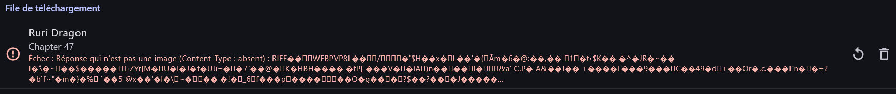

# Retours sur la version 0.2.1-test

Déposez ici vos notes, le plan de tests rempli et les rapports d'erreur exportés.

# Plan de tests — version 0.2.1-test (Windows)

Pour chaque test : notez **OK**, **KO** (avec ce qui s'est passé) ou **non testé** dans la colonne
« Résultat ». Déposez votre retour dans `testUtilisateur/retour/v0.2.1-test/`.

Avant de commencer : sauvegardez votre base (copie du dossier
`%APPDATA%\io.github.zerma1\bibliotheque_perso`), et faites un export (test D1) : il servira
pour l'import.

## A. Vos retours de la 0.2.0-test

| # | Test | Attendu | Résultat |
|---|------|---------|----------|
| A1 | Lancer l'application | « v0.2.1 » **tout en bas** de la colonne de gauche | ok|
| A2 | Onglet Mises à jour | « Nouveau » seulement sur les titres dont un chapitre non lu est sorti il y a moins de 7 jours (plus de « Nouveau » pour un chapitre de 2023) | ok|
| A3 | Ouvrir un long chapitre, descendre jusqu'en bas puis **remonter** | Aucun saut vers le bas en remontant | ok|
| A4 | Paramètres | Sections pliables (Mes langues, Recherche des nouveaux chapitres, Téléchargements et conservation, Sites, Sauvegarde et export, À propos) ; un résumé visible même replié | ok|
| A5 | Fiche d'un titre → section « Sites » | Repliée au départ, en-tête « Sites (n) » ; se déplie au clic | ok|

## B. Site en « simple lien » (à faire avec une page que l'application ne sait pas lire)

Dans la 0.2.0-test, ruri-dragon.online a été lu correctement : c'est très bien, mais il faut une
page **illisible** pour essayer le simple lien. Utilisez par exemple la page Wikipédia du titre
(ce n'est pas un site de lecture, l'application la refuse forcément).

| # | Test | Attendu | Résultat |
|---|------|---------|----------|
| B1 | Fiche de Ruri Dragon → « Sites » → « Ajouter un autre site » → `https://fr.wikipedia.org/wiki/Ruri_Dragon` | Refus avec une explication, et un bouton « Ajouter quand même comme simple lien » | ok|
| B2 | Appuyer sur « Ajouter quand même comme simple lien » | Le site apparaît dans « Sites » avec « lien seul », aucun chapitre ajouté | ok|
| B3 | Sur ce lien : « Ouvrir dans le navigateur » | La page Wikipédia s'ouvre dans votre navigateur | ok|
| B4 | Sur ce lien : « Essayer de le lire » | Message d'échec clair ; le site reste « lien seul » | ok|
| B5 | Onglet Mises à jour → « Rechercher les nouveaux chapitres » | Aucune erreur au sujet de ce lien | ok|
| B6 | Sur ce lien : « Retirer » | Le lien disparaît | ok|

## C. « Pourquoi ce site n'est pas lisible ? » (aide pour ajouter un site)

Ces écrans servent quand un site **refuse** d'être ajouté : ils expliquent pourquoi.

| # | Test | Attendu | Résultat |
|---|------|---------|----------|
| C1 | Onglet Sources → « Ajouter un site » → sous le champ d'adresse, déplier « Critères de lecture » | Un court texte qui explique ce dont l'application a besoin pour lire un site | ok|
| C2 | Dans ce même écran, coller `https://fr.wikipedia.org/wiki/Ruri_Dragon` → Ajouter | Échec, puis un bouton « Pourquoi ce site n'est pas lisible ? » | NOK - sit lisible|
| C3 | Appuyer sur ce bouton | Une liste de raisons (ex. aucun lien de chapitre trouvé) | NOK - teste précédent|
| C4 | (facultatif) « Réglages avancés (sélecteurs CSS) » | Réservé aux connaisseurs : vous pouvez simplement vérifier que la section se déplie | NOK - teste précédent|

## D. Export et import (nouveau)

| # | Test | Attendu | Résultat |
|---|------|---------|----------|
| D1 | Paramètres → Sauvegarde et export → « Exporter mes titres et mes sites » | Deux fichiers créés (JSON et Markdown) | ok|
| D2 | « Importer un export » | Une fenêtre liste vos exports JSON (le plus récent en haut) | ok|
| D3 | Choisir l'export de D1 → Importer | Bilan : 0 titre ajouté, titres « déjà présents », aucun doublon dans la bibliothèque | ok|
| D4 | (sur l'autre PC, ou après avoir retiré un titre) importer un export qui contient ce titre | Le titre revient avec ses listes et ses sites ; ses chapitres arrivent après « Rechercher les nouveaux chapitres » | |
| D5 | Coller un chemin vers un fichier qui n'est pas un export | Message clair, rien n'est importé | ok|

## E. Non-régression rapide

| # | Test | Attendu | Résultat |
|---|------|---------|----------|
| E1 | Favoris / Suivis | Téléchargements automatiques comme avant | ok|
| E2 | Lire un chapitre puis « Chapitre suivant » | Le chapitre quitté passe en lu | ok|
| E3 | Scan-Manga sur l'autre PC | Comme dans la 0.2.0-test | ok|

## Remarques libres

- lors d'un ajout, la case favorit est cocher par defaut. il faut la laisser mais décocher par defaut
- il manque la possibilitée d'ajouter nos liste personel
- echeque de téléchargement avec un code illisible
- CRUD incomplet pour les source
- CRUD incomplet pour les titres